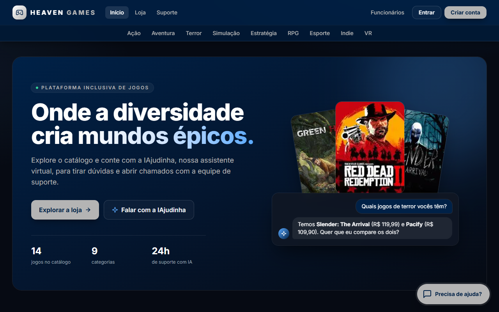
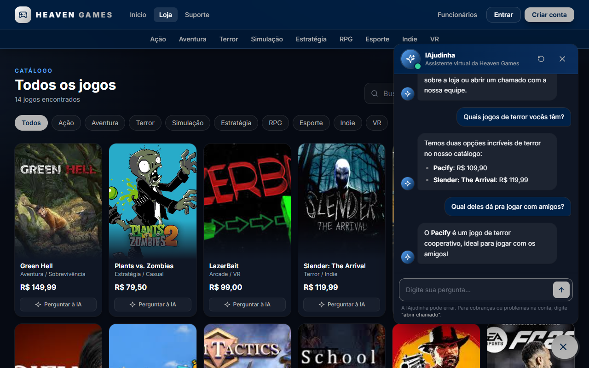
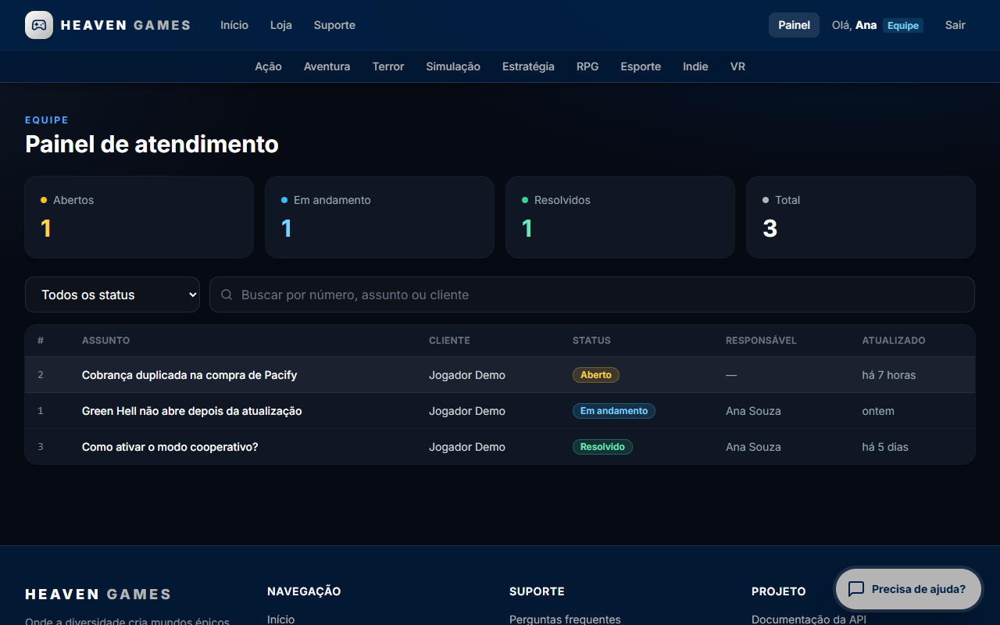

# Heaven Games · IAjudinha

Loja de jogos fictícia com uma central de suporte completa: a **IAjudinha**, um chatbot com IA (Google Gemini) que conhece o catálogo e abre chamados durante a conversa; uma área para o cliente acompanhar seus chamados; e um **painel de atendimento** para a equipe responder e resolver cada caso.

> Projeto desenvolvido como TCC (PIM IV) e depois refatorado para portfólio: API segura com JWT, banco relacional com migrations, front-end modular e ambiente completo em Docker.



## Funcionalidades

- **Catálogo** com destaques, filtro por categoria, busca e ordenação por preço ou nome, carregado da API.
- **IAjudinha (chat com IA):** responde em cerca de 1 segundo usando o catálogo real da loja como contexto, lembra do que foi dito na conversa e abre chamados pelo próprio chat (pedindo login quando necessário e continuando o fluxo depois).
- **Contas de cliente:** cadastro com validação, login e sessão com JWT.
- **Meus chamados:** lista com status e histórico de mensagens, em formato de conversa com a equipe.
- **Painel de atendimento (equipe):** fila priorizada, indicadores por status, busca, resposta ao cliente e mudança de status. A primeira resposta já atribui o responsável e coloca o chamado "Em andamento".
- **API REST documentada** com OpenAPI + Scalar.

| Conversa com a IAjudinha | Painel de atendimento |
| --- | --- |
|  |  |

## Tecnologias

| Camada | Tecnologias |
| --- | --- |
| Back-end | ASP.NET Core 10 (Web API), Entity Framework Core 10, autenticação JWT, BCrypt, rate limiting, OpenAPI + Scalar |
| Banco de dados | SQL Server 2022 |
| Front-end | HTML, JavaScript (ES Modules, sem framework), Tailwind CSS |
| IA | Google Gemini API (chamada pelo servidor) |
| Infraestrutura | Docker e Docker Compose |

## Como rodar

### Opção 1: GitHub Codespaces (sem instalar nada)

[](https://codespaces.new/diogoduo/Heaven-Games?quickstart=1)

1. Clique no botão acima e depois em **Create codespace**. Se você já criou um antes, o mesmo link oferece retomá-lo.
2. Aguarde a preparação. Na primeira vez leva alguns minutos, porque as imagens do SQL Server e da API são baixadas e montadas.
3. O site abre sozinho numa nova aba. Se não abrir, vá na aba **Portas** (Ports) do editor e clique no globo ao lado da porta **8080**. Se aparecer um erro logo no início, aguarde alguns segundos e recarregue: a API ainda está criando o banco.

As senhas são geradas automaticamente no primeiro uso. Para a IAjudinha responder, cadastre a chave do Gemini como secret do Codespaces em [github.com/settings/codespaces](https://github.com/settings/codespaces) → **New secret**, com o nome `GEMINI_API_KEY` e acesso a este repositório. Se o Codespace já estiver aberto, reinicie-o para aplicar.

Para voltar depois, acesse [github.com/codespaces](https://github.com/codespaces) e abra o Codespace existente: os dados ficam salvos. Ele desliga sozinho após 30 minutos sem uso, e o plano gratuito do GitHub inclui cerca de 60 horas por mês. O link do site é privado; para mostrar a outra pessoa, mude a visibilidade da porta 8080 para **Public** na aba Portas.

### Opção 2: Docker

Pré-requisito: [Docker Desktop](https://www.docker.com/products/docker-desktop/).

```bash
cp .env.example .env        # ajuste as senhas; a chave do Gemini é opcional
docker compose up --build
```

- Site: http://localhost:8080
- Documentação da API: http://localhost:8080/scalar

O banco é criado automaticamente na primeira execução (migrations + dados de demonstração).

### Opção 3: `dotnet run` (desenvolvimento)

Pré-requisitos: [.NET 10 SDK](https://dotnet.microsoft.com/download) e Docker (apenas para o SQL Server).

```bash
cp .env.example .env
docker compose up -d db

cd IAjudinhaApi
dotnet user-secrets set "ConnectionStrings:DefaultConnection" "Server=localhost,1433;Database=IAjudinhaDB;User Id=sa;Password=<SA_PASSWORD do .env>;TrustServerCertificate=True"
dotnet user-secrets set "Gemini:ApiKey" "<sua chave>"   # opcional
dotnet run
```

Acesse http://localhost:5131. Em desenvolvimento, se `Jwt:Key` não for configurada, a API usa uma chave temporária.

### Contas de demonstração

| Perfil | E-mail | Senha |
| --- | --- | --- |
| Cliente | `jogador@exemplo.com` | `Jogador@123` |
| Funcionário | `suporte@heavengames.com` | `Suporte@123` |

Elas são criadas na primeira execução junto com alguns chamados de exemplo. Para desativar, defina `DadosDemo__Habilitar=false`.

### Ativando a IA

1. Gere uma chave gratuita em [Google AI Studio](https://aistudio.google.com/apikey).
2. Codespaces: cadastre o secret `GEMINI_API_KEY`, como explicado na opção 1. Docker: preencha `GEMINI_API_KEY` no `.env` e rode `docker compose up -d` de novo. Com `dotnet run`: use o `user-secrets` mostrado acima.

Sem a chave, o chat continua abrindo chamados e avisa que as respostas com IA estão desativadas. O modelo pode ser trocado em `Gemini:Modelo` (no Docker, pela variável `GEMINI_MODELO` do `.env`). O padrão é `gemini-flash-lite-latest`, que responde em cerca de 1 segundo; o `gemini-flash-latest` é mais capaz, mas chegou a levar mais de 30 segundos e a recusar pedidos por sobrecarga. `Gemini:NivelRaciocinio` (padrão `low`) limita quanto o modelo "pensa" antes de responder, e `Gemini:UsarBuscaGoogle` permite que a IA consulte a web.

## Endpoints

| Método | Rota | Acesso | Descrição |
| --- | --- | --- | --- |
| GET | `/api/jogos` | Público | Catálogo da loja |
| POST | `/api/auth/cadastro` | Público | Cria conta de cliente e devolve o token |
| POST | `/api/auth/login` | Público | Login de cliente |
| POST | `/api/auth/funcionarios/login` | Público | Login da equipe |
| GET | `/api/auth/me` | Autenticado | Dados do usuário do token |
| GET | `/api/chamados/meus` | Cliente | Chamados do cliente logado |
| POST | `/api/chamados` | Cliente | Abre um chamado |
| GET | `/api/chamados?status=Aberto` | Equipe | Fila de atendimento |
| GET | `/api/chamados/{id}` | Dono ou equipe | Detalhes com histórico de mensagens |
| PATCH | `/api/chamados/{id}/status` | Equipe | Altera o status |
| GET / POST | `/api/chamados/{id}/interacoes` | Dono ou equipe | Lista ou envia mensagens |
| GET / POST / PUT | `/api/funcionarios` | Equipe | Gestão da equipe |
| POST | `/api/chat` | Público (com limite) | Conversa com a IAjudinha |

O arquivo [`IAjudinhaApi.http`](IAjudinhaApi/IAjudinhaApi.http) traz exemplos prontos para executar no VS Code ou no Visual Studio.

## Estrutura

```
├── .devcontainer/              # configuração do GitHub Codespaces
├── docker-compose.yml          # SQL Server + API
├── .env.example                # variáveis de ambiente (copie para .env)
└── IAjudinhaApi/
    ├── Controllers/            # Auth, Chamados, Interacoes, Funcionarios, Jogos, Chat
    ├── Data/                   # DbContext, catálogo inicial, dados de demonstração
    ├── DTOs/                   # contratos de entrada e saída, com validações
    ├── Migrations/             # histórico do banco (EF Core)
    ├── Models/                 # entidades
    ├── Seguranca/              # JWT, perfis, rate limiting
    ├── Services/               # integração com o Gemini
    ├── wwwroot/                # front-end (index.html + módulos JS)
    └── Program.cs
```

## Decisões técnicas

- **Chave da IA só no servidor.** O front-end conversa com `/api/chat`, e a API chama o Gemini. Na versão original, a chave ficava exposta no HTML.
- **Autorização por perfil.** O token JWT carrega o perfil (`Cliente` ou `Funcionario`). Clientes só enxergam os próprios chamados, e uma consulta centraliza essa regra (`ChamadosVisiveisPara`).
- **Senhas com BCrypt.** O login não revela se um e-mail está cadastrado: a resposta e o tempo de verificação são os mesmos nos dois casos.
- **Limite de requisições por IP** no login e no cadastro (10/min) e no chat (15/min), para dificultar ataques de força bruta e proteger a cota da IA.
- **Front-end servido pela própria API:** um único deploy, sem necessidade de CORS.
- **Contexto da IA vindo do banco:** o catálogo é injetado nas instruções do modelo, então a IAjudinha responde com jogos e preços reais e não inventa produtos.
- **IA rápida e resiliente:** modelo Flash-Lite com raciocínio limitado (respostas em ~1 s) e uma nova tentativa automática quando o Gemini responde 500/503 por sobrecarga.
- **Datas em UTC** no banco, convertidas para o fuso do navegador na exibição.
- **Erros padronizados** em `ProblemDetails`, com mensagens de validação em português.

## Próximos passos

- Testes automatizados (xUnit + `WebApplicationFactory`).
- Gerar o CSS do Tailwind no build em vez de usar o CDN.
- Notificar o cliente por e-mail quando a equipe responder.
- Hospedagem permanente, com link fixo sempre no ar (hoje a demonstração online roda pelo Codespaces).

<!-- Autor: adicione aqui seu nome, LinkedIn e GitHub. -->
